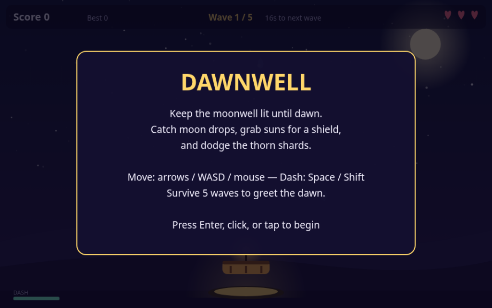
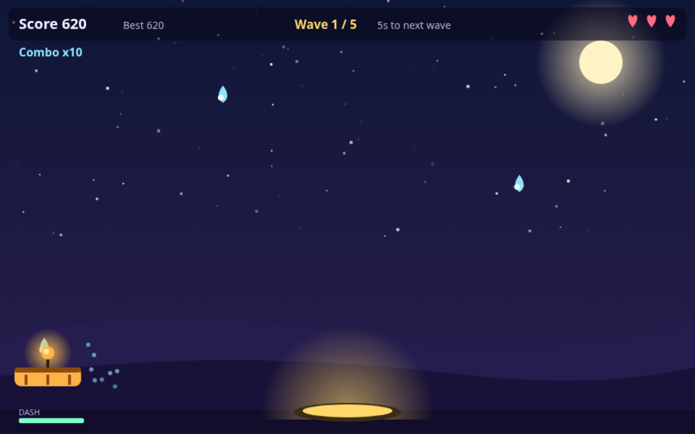
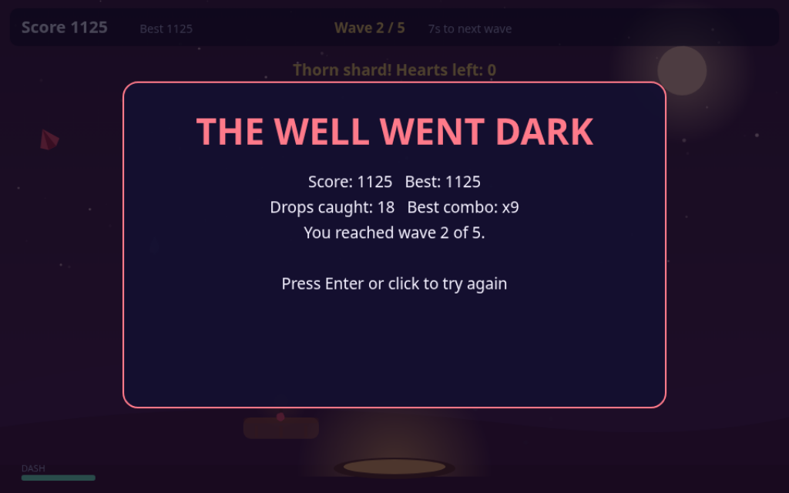
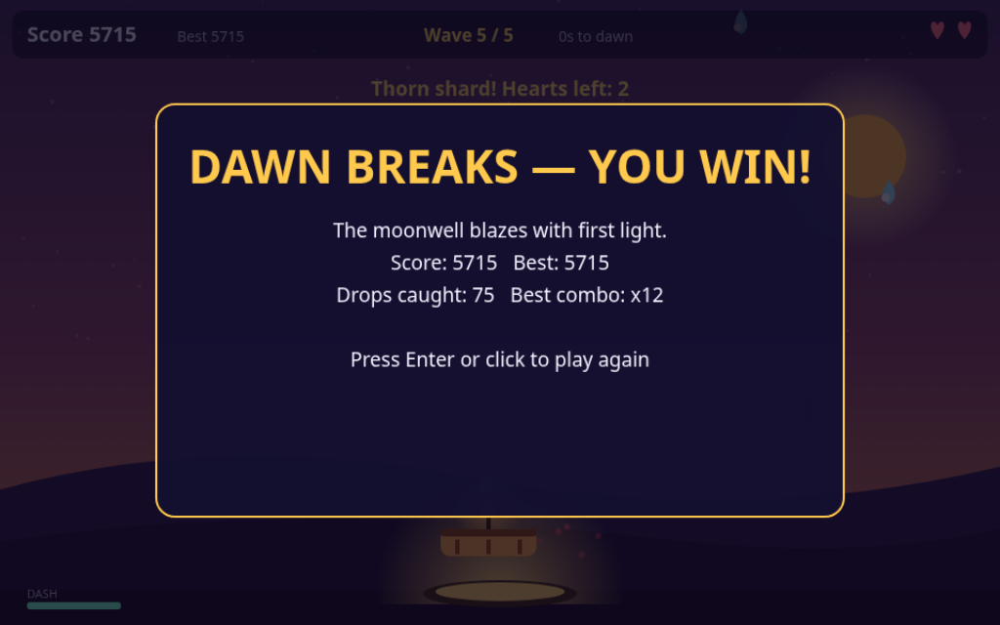

# Dawnwell

An original canvas arcade game built with plain JavaScript and the Canvas API. Catch the falling light, dodge the dark, and keep the well lit as the pace rises.

Dawnwell was created as an entry to the make.fun **best-game-01** bounty (November 2026) and passed the full submission kit check, 15 of 15.

## Play

Open `game/index.html` in a browser, or serve the folder with any static file server. No build step and no dependencies.

Optional URL parameters:

- `?seed=N` fixes the falling pattern for a repeatable run
- `?shot=start|play|end|win` stages a fixed scene (used for the screenshots below)

## Screenshots

| Start | In play |
| --- | --- |
|  |  |

| End | Win |
| --- | --- |
|  |  |

## Structure

- `game/src/` : game modules (config, input, entities, render, audio, seeded random)
- `game/index.html` : entry page
- `screenshots/` : staged captures from the seeded screenshot mode

## Author

0xTreasure · X: [@0xTreasureDev](https://x.com/0xTreasureDev)
